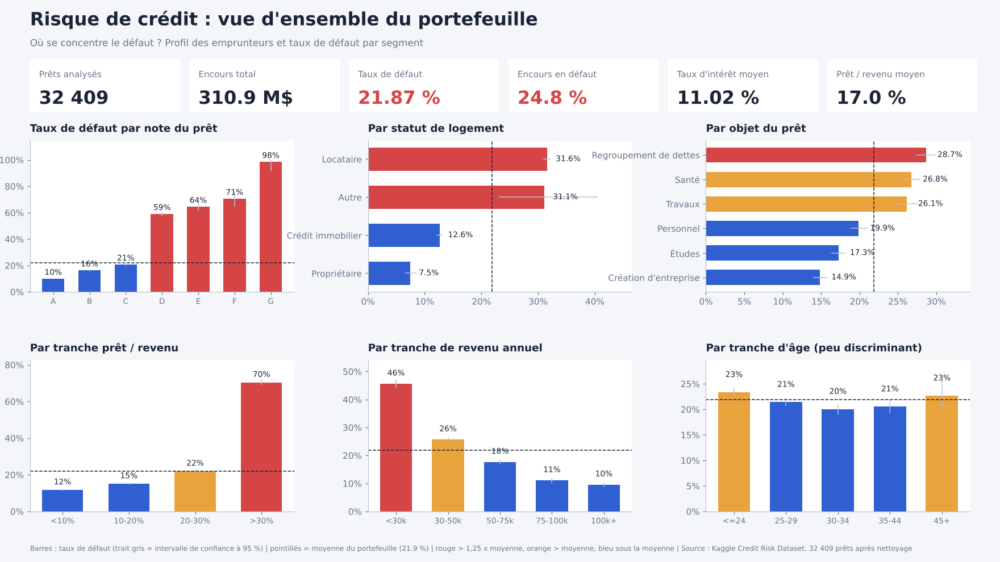

# Analyse du risque de crédit bancaire

> Projet de data analyse de bout en bout : profils d'emprunteurs, facteurs de défaut, indicateurs de risque, comparaison de groupes, scoring et recommandations d'octroi.
> **Outils : Python (pandas, SciPy, statsmodels, scikit-learn), SQL (SQLite), statistiques, Power BI.**



## 1. Contexte et objectifs
Une banque veut savoir **qui fait défaut, pourquoi, et comment ajuster sa politique d'octroi**. Le projet répond à quatre questions :

1. Quels sont les profils des emprunteurs ?
2. Quels facteurs sont associés aux défauts de paiement ?
3. Quels indicateurs de risque peut-on construire pour piloter le portefeuille ?
4. Comment se comparent les différents groupes de clients ?

## 2. Données
| | |
|---|---|
| **Source** | Credit Risk Dataset – Kaggle (auteur : *laotse*) : <https://www.kaggle.com/datasets/laotse/credit-risk-dataset> |
| Copie également publiée sur OpenML | <https://www.openml.org/d/43454> |
| Contenu | 12 variables par prêt : âge, revenu, logement, ancienneté d'emploi, objet du prêt, note du prêt (A–G), montant, taux, ratio prêt/revenu, défaut antérieur, ancienneté de crédit, **statut (1 = défaut)** |
| Taille utilisée | 32 580 lignes brutes → **32 409 prêts** après nettoyage |

> **Transparence.** Mon environnement n'accédait pas à Kaggle : le CSV de `data/raw/` provient d'une copie publique de ce même jeu (dépôt GitHub *JoshLG18/DSE-EMP-Project*). Cette copie compte 32 580 lignes alors que la source en annonce 32 581. **Pour une publication, retéléchargez le fichier depuis Kaggle**, placez-le dans `data/raw/credit_risk_dataset.csv` et relancez les scripts : tous les chiffres se recalculent.

## 3. Structure du dépôt
```
├── data/raw/credit_risk_dataset.csv     # données brutes
├── python/
│   ├── 01_nettoyage_donnees.py          # audit, nettoyage, enrichissement -> CSV + base SQLite
│   ├── 02_analyse_scoring.py            # stats, tests, indicateurs, modèle, simulation de seuil
│   └── 03_dashboards.py                 # 3 tableaux de bord (PNG + PDF)
├── sql/requetes_sql.sql                 # 16 requêtes testées (agrégats, CTE, fenêtres, vue)
├── powerbi/                             # CSV allégé + guide (mesures DAX, pages)
├── dashboards/                          # dashboard_1..3.png et PDF
└── outputs/                             # tables de résultats (CSV) et resultats_cles.json
```
**Exécution :**
```bash
pip install -r requirements.txt
python python/01_nettoyage_donnees.py
python python/02_analyse_scoring.py
python python/03_dashboards.py
sqlite3 data/processed/credit_risk.db < sql/requetes_sql.sql   # ou tout client SQLite
```

## 4. Nettoyage (journal complet : `outputs/tables/audit_qualite.csv`)
| Problème | Lignes | Décision |
|---|---:|---|
| Doublons exacts | 165 | Supprimés |
| Âge > 100 ans (123 et 144 ans) | 4 | Supprimés |
| Ancienneté d'emploi > âge − 14 ans (ex. 123 ans) | 2 | Supprimés |
| Taux d'intérêt manquant | 3 094 | Médiane **par note de prêt** (le taux dépend de la note) + drapeau |
| Ancienneté d'emploi manquante | 887 | Médiane par statut de logement + drapeau |
| Revenus extrêmes (> P99,9) | 33 | Conservés et signalés |
| Ratio prêt/revenu incohérent avec revenu et montant | 387 | Conservés et signalés (voir limites) |

**Total retiré : 171 lignes (0,52 %).** Chaque imputation conserve un drapeau (`taux_manquant`, `anciennete_manquante`).

## 5. Résultats principaux
Taux de défaut global : **21,87 %** ; encours **310,9 M$** dont **24,8 %** en défaut.

### 5.1 Profil : défaillants vs emprunteurs sains
| Variable | Défaut | Sain | Écart |
|---|---:|---:|---:|
| Ratio prêt/revenu | 24,7 % | 14,9 % | **+66 %** |
| Taux d'intérêt | 13,05 % | 10,45 % | +25 % |
| Montant du prêt | 10 854 $ | 9 239 $ | +18 % |
| Ancienneté d'emploi | 4,1 ans | 4,9 ans | −17 % |
| Revenu annuel | 49 093 $ | 70 597 $ | **−31 %** |
| Âge | 27,5 ans | 27,8 ans | −1 % |

L'emprunteur type est jeune (âge médian 26 ans), gagne 55 000 $ (médiane) et emprunte environ 9 600 $, soit 17 % de son revenu.

### 5.2 Taux de défaut par groupe (intervalles de confiance dans `segments_risque.csv`)
| Dimension | Du moins risqué au plus risqué |
|---|---|
| **Note du prêt** | A 10 % · B 16 % · C 21 % · **D 59 %** · E 64 % · F 71 % · G 98 % |
| **Logement** | Propriétaire 7,5 % · Crédit immo 12,6 % · Autre 31,1 % · **Locataire 31,6 %** |
| **Prêt / revenu** | < 10 % : 11,8 % · 10–20 % : 15,1 % · 20–30 % : 22,0 % · **> 30 % : 70,4 %** |
| **Revenu annuel** | 100 k+ : 9,6 % · 75–100 k : 11,0 % · 50–75 k : 17,6 % · 30–50 k : 25,7 % · **< 30 k : 45,6 %** |
| **Objet du prêt** | Création d'entreprise 14,9 % · Études 17,3 % · Personnel 19,9 % · Travaux 26,2 % · Santé 26,8 % · **Regroupement de dettes 28,7 %** |
| Âge | de 20,1 % à 23,3 % : quasi plat |


### 5.3 Quels facteurs comptent vraiment ?
- **Les plus discriminants** (valeur d'information) : ratio prêt/revenu (0,92), note (0,88), taux (0,72), revenu (0,41), logement (0,38). L'âge (0,005) et l'ancienneté de crédit (0,004) n'apportent rien.
- **Tests du chi-deux** : toutes les variables catégorielles sont significatives (p < 0,001) ; les plus fortes tailles d'effet (V de Cramér) sont le ratio (0,44), la note (0,42) et le taux (0,37). L'âge est significatif mais d'effet négligeable (V = 0,03) : avec 32 000 lignes, « significatif » ne veut pas dire « utile ».
- **Régression logistique** (toutes choses égales par ailleurs, pseudo-R² de McFadden 0,33) : être locataire multiplie les chances de défaut par **9,9** (vs propriétaire), +10 points de ratio par **2,56**, regroupement de dettes par 2,35 et santé par 2,04 (vs études). L'ancienneté d'emploi protège légèrement (0,97 par année).
- **Piège de lecture : le « défaut antérieur ».** Brut, il double presque le risque (37,9 % vs 18,4 %, +19,4 points). Mais **à note égale l'effet disparaît** (note C : 19,7 % avec défaut antérieur contre 21,8 % sans ; odds ratio ajusté 1,01, p = 0,85). Tous les emprunteurs avec défaut antérieur sont classés C à G : la note capte déjà l'information.

### 5.4 Indicateurs de risque construits
| Indicateur | Définition | Usage |
|---|---|---|
| Taux de défaut et **lift** | taux du segment / taux global | repérer les segments à surveiller |
| Part de l'encours en défaut | encours défaillant / encours total | exposition financière |
| **Marge ajustée du risque** | taux d'intérêt moyen − taux de défaut × LGD (45 %, hypothèse Bâle) | un segment est-il rentable ? |
| **PD du modèle** | probabilité de défaut estimée (gradient boosting, notée hors échantillon) | décision d'octroi |
| Perte attendue | PD × LGD × montant | provisionnement |
| Bandes de risque | PD < 10 % · 10–25 % · 25–50 % · > 50 % | pilotage |

**Marge ajustée par note :** A +2,9 · B +3,7 · C +4,1 · **D −11,2 · E −12,0 · F −13,1 · G −24,1 points**. Les notes D à G perdent de l'argent même au taux facturé.

### 5.5 Modèle de scoring


| Modèle | AUC (test) | Gini | KS |
|---|---:|---:|---:|
| Régression logistique (explicative) | 0,870 | 0,740 | 0,607 |
| **Gradient boosting (score retenu)** | **0,929** | 0,858 | 0,728 |

Variables les plus utiles au score (baisse d'AUC par permutation) : ratio prêt/revenu (0,24), logement (0,08), taux (0,08), montant (0,07), objet (0,04). La bande « très élevé » (> 50 % de PD) ne représente que **16 % des prêts mais 71 % des défauts** et 75 % de la perte attendue.

## 6. Décisions que ce projet permet de prendre
| # | Décision recommandée | Preuve | Impact estimé |
|---|---|---|---|
| 1 | **Plafonner le prêt/revenu à 30 % pour les locataires** (et « autre ») : refus ou revue manuelle au-delà | Locataires/autre avec ratio ≥ 31 % : **100 % de défaut** (2 354 prêts), contre 28 % juste en dessous | 34,9 M$ d'encours concernés, **33 % de tous les défauts** |
| 2 | **Ne plus octroyer, ou retarifer, les notes D à G** | 61 % de défaut sur 4 887 prêts ; marge ajustée de −11 à −24 points | Couvrir la seule perte attendue exigerait un taux ≈ 27 %, contre 15–20 % facturés |
| 3 | **Adopter un score de PD avec seuil de refus à 20 %** | À ce seuil : 78 % d'acceptation, taux de défaut du portefeuille accepté **6,4 % contre 21,9 %** | **77 % des défauts évités** (≈ 62,6 M$ d'encours défaillant) pour 6 % de bons clients refusés |
| 4 | **Circuit à 4 niveaux** : PD < 10 % acceptation automatique ; 10–25 % acceptation avec prix ajusté ; 25–50 % revue manuelle ; > 50 % refus | Bande faible = 61 % des prêts pour 12 % des défauts et marge ajustée de +7,7 pts | Automatiser les 61 % de dossiers à faible risque |
| 5 | **Durcir les conditions sur regroupement de dettes, santé et travaux** (plafond de ratio, garanties) | 26–29 % de défaut contre 15–17 % pour création d'entreprise et études ; odds ratios de 2,0 à 2,4 | Cibler 14 800 prêts |
| 6 | **Surveiller les revenus < 30 k$** et les ratios 20–30 % | 45,6 % de défaut sous 30 k$ ; 22 % à 20–30 % de ratio | Alerte précoce |
| 7 | **Ne pas utiliser le défaut antérieur seul, ni l'âge** comme critères de refus | Défaut antérieur : effet nul à note égale ; âge : effet négligeable (IV 0,005) et sensible sur le plan de la non-discrimination | Évite des refus injustifiés |

## 7. Limites (à lire avant de publier ou de présenter)
1. **Artefact probable dans les données.** Le passage de 28 % de défaut (ratio 30 %) à 100 % (ratio 31 %) chez les locataires est trop net pour un vrai portefeuille : il suggère un jeu de données partiellement synthétique. Il gonfle les performances du modèle. **Hors de ce segment, l'AUC passe de 0,929 à 0,892** : c'est le chiffre prudent à retenir. La décision n° 1 reste valable comme règle de politique, mais le chiffre « 100 % » ne doit pas être pris pour un taux réel.
2. 387 lignes ont un ratio prêt/revenu incohérent avec leur revenu et leur montant (toutes en défaut) ; elles sont conservées et signalées (`ratio_incoherent`).
3. **Biais de sélection** : seuls les prêts accordés sont observés ; on ne sait rien des demandes refusées.
4. **Pas de dimension temporelle** : impossible de tester la stabilité dans le temps, ni de suivre une cohorte.
5. LGD = 45 % est une **hypothèse**, pas une mesure ; coûts opérationnels et de refinancement non pris en compte.
6. Le modèle est bien classant mais pas parfaitement calibré (bande 25–50 % : PD estimée 33 % pour 28 % observé).
7. La note du prêt et le taux d'intérêt sont fixés par la banque *après* évaluation : ils reflètent un jugement antérieur et ne peuvent pas servir tels quels pour décider d'un nouveau dossier sans cette information.

## 8. Pistes d'amélioration
Valider sur un jeu hors période, calibrer les probabilités (Platt / isotonique), ajouter une analyse de rentabilité avec coûts réels, tester l'équité du modèle par groupe, puis suivre le score en production (PSI, dérive).

## 9. Auteur
Espérant ODJO – étudiant ingénieur informatique (EILCO, Calais), recherche d'alternance en Data Analyst / Data Engineer.
